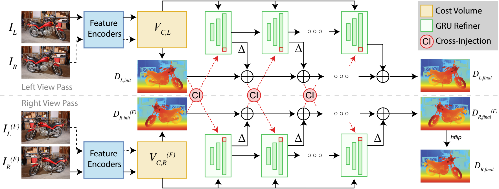

# Left-Right-Consistent Iterative Stereo Matching via Cross-Injection

Reference implementation of **cross-injection (CI)**: a lightweight, bolt-on
extension that makes an iterative stereo matcher binocularly consistent.

**Paper:** [arXiv:2611.09458](https://arxiv.org/abs/2611.09458) (WACV 2027) ·
**Weights:** [facebook/stereo_crossinjection](https://huggingface.co/facebook/stereo_crossinjection)
on the Hugging Face Hub



<sub>Images: Middlebury 2014 stereo dataset (Scharstein et al., GCPR 2014).</sub>

Most modern stereo matchers predict only the left disparity. Predicting the
right one too — by flipping and swapping the input pair — gives two passes that
share weights but never talk, so the two views disagree. Cross-injection
connects them: at every refinement step, each pass is handed the per-pixel
**signed left-right inconsistency** with the other, masked by co-visibility, as
an extra input cue.

> This repository contains only the cross-injection module and thin adapters.
> The stereo matchers it extends, [S2M2](https://github.com/junhong-3dv/s2m2)
> and [FoundationStereo](https://github.com/NVlabs/FoundationStereo), are
> referenced as git submodules under `third_party/` and are under their own
> non-commercial, research-only licences (see [Licence](#licence)).

## Install

```bash
git clone --recursive https://github.com/facebookresearch/stereo_crossinjection
cd stereo_crossinjection
conda env create -f environment.yml && conda activate crossinj
pip install -e ".[foundationstereo]"     # or `pip install -e .` for S2M2 only
```

`environment.yml` installs CPU builds of torch 2.6. For a GPU, install the CUDA
build matching your driver, e.g.

```bash
pip install torch==2.6.0+cu126 torchvision==0.21.0+cu126 \
    --index-url https://download.pytorch.org/whl/cu126
```

Building a FoundationStereo model downloads its frozen
[DepthAnythingV2-Large](https://huggingface.co/depth-anything/Depth-Anything-V2-Large)
backbone and DINOv2's model code on first use. If the DINOv2 download fails
with `HTTP Error 403: rate limit exceeded`, set `GITHUB_TOKEN` to any GitHub
token and retry.

## Checkpoints

The weights are on the Hugging Face Hub at
[facebook/stereo_crossinjection](https://huggingface.co/facebook/stereo_crossinjection).
The repository is **gated**: request access on the model page, then log in with
the approved account:

```bash
hf auth login                  # or set HF_TOKEN
hf download facebook/stereo_crossinjection --local-dir checkpoints
```

| model | file |
|---|---|
| S2M2-XL + CI | `s2m2_xl_ci.pth` |
| FoundationStereo + CI | `foundationstereo_ci.pth` |

From Python, `crossinj.hub.download_checkpoint("s2m2_xl")` (or
`"foundation_stereo"`) downloads a checkpoint into the Hugging Face cache and
returns its path.

## Quick start

Run a released model on your own rectified stereo pair (left image first):

```bash
python scripts/demo.py --left left.png --right right.png \
    --checkpoint checkpoints/s2m2_xl_ci.pth --out out/s2m2
python scripts/demo.py --arch foundation_stereo --left left.png --right right.png \
    --checkpoint checkpoints/foundationstereo_ci.pth --out out/fs
```

It writes both disparities as `.npy` (float32, pixels) and as colourised
`.png`. Without `--checkpoint` it downloads the released checkpoint. Use
`--scale 0.5` to save time and memory on large images.

## Python API

```python
import torch
from crossinj.adapters.s2m2 import CrossInjectionS2M2
from crossinj.io import load_checkpoint, load_image

device = "cuda" if torch.cuda.is_available() else "cpu"
model = CrossInjectionS2M2(model_size="XL")
load_checkpoint(model, "checkpoints/s2m2_xl_ci.pth")
model = model.to(device).eval()

left = load_image("left.png", device=device)          # (1, 3, H, W) float in [0, 255]
right = load_image("right.png", device=device)
with torch.inference_mode():
    disp_left, disp_right = model(left, right)        # each (1, 1, H, W), in pixels
```

```python
import torch
from crossinj.adapters.foundation_stereo import (
    CrossInjectionFoundationStereo, foundation_stereo_cfg)
from crossinj.io import load_checkpoint, load_image

device = "cuda" if torch.cuda.is_available() else "cpu"
model = CrossInjectionFoundationStereo(foundation_stereo_cfg())
load_checkpoint(model, "checkpoints/foundationstereo_ci.pth")
model = model.to(device).eval()

left = load_image("left.png", device=device)
right = load_image("right.png", device=device)
with torch.inference_mode():
    disp_left, disp_right = model(left, right, iters=32)
```

Inputs are RGB in [0, 255] (not [0, 1]), left image first, any size; the
adapters pad and crop internally. The right disparity is returned in
right-image convention (right pixel `x` matches left pixel `x + d`).

## Citation

```bibtex
@inproceedings{knott2027crossinjection,
  title     = {Left-Right-Consistent Iterative Stereo Matching via Cross-Injection},
  author    = {Knott, Manuel and Luvizon, Diogo and
               Scharstein, Daniel and Vansteenkiste, Elias},
  booktitle = {IEEE/CVF Winter Conference on Applications of Computer Vision (WACV)},
  year      = {2027}
}
```

Please also cite the base model you build on —
[S2M2](https://github.com/junhong-3dv/s2m2) (Min et al., ICCV 2025) or
[FoundationStereo](https://github.com/NVlabs/FoundationStereo) (Wen et al.,
CVPR 2025).

## Licence

This repository's own code is released under the FAIR Noncommercial Research
License — see [LICENSE](LICENSE). One piece of it is adapted from
third-party code, remains under its original licence and carries attribution
where it appears: the correlation lookup in `crossinj/compat.py`, from
[S2M2](https://github.com/junhong-3dv/s2m2) (CC BY-NC 4.0).

The released checkpoints
([facebook/stereo_crossinjection](https://huggingface.co/facebook/stereo_crossinjection))
are released under the FAIR Noncommercial Research License. The FAIR licence does not cover the upstream models in `third_party/` or their
original weights, which carry their own non-commercial licences.
